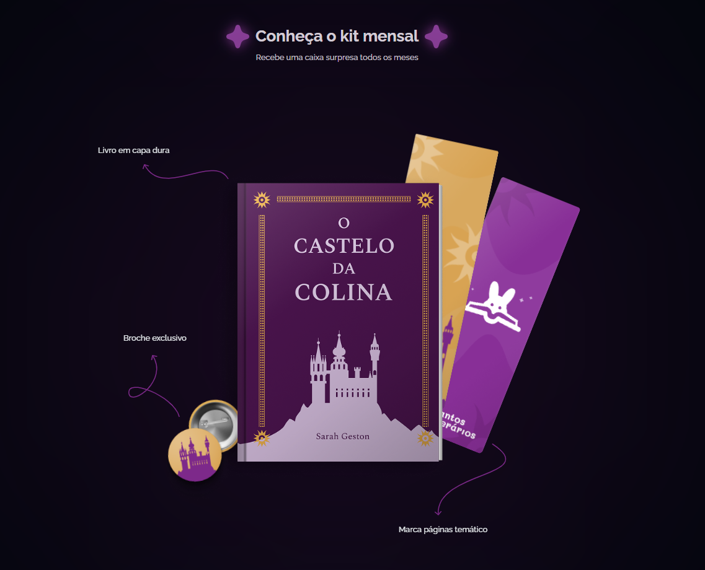
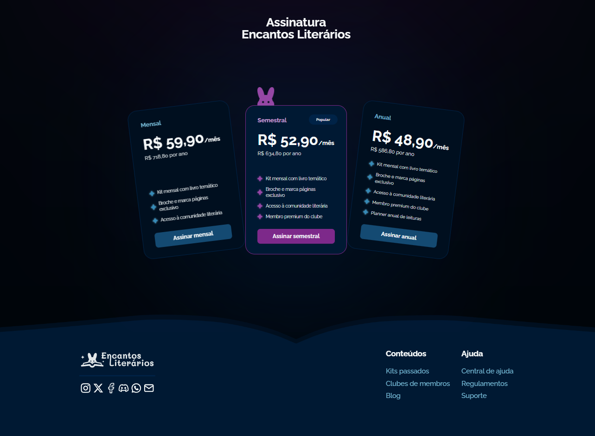

# Encantos Literários — Clube de Assinatura

Landing page responsiva para um clube de assinatura de livros, criada para apresentar a proposta do serviço, o kit mensal e os planos disponíveis.

## Sobre o projeto

O Encantos Literários é uma landing page estática com identidade visual inspirada em fantasia e literatura. O projeto foi desenvolvido para praticar estruturação semântica, responsividade, animações CSS e interações visuais leves no navegador.

## Funcionalidades

- Hero com apresentação do clube e chamada para ação.
- Kit mensal com interação por hover, toque e teclado.
- Planos mensal, semestral e anual.
- Destaque visual para o plano recomendado.
- Navegação suave até a seção de planos.
- Animações de entrada das seções durante a rolagem.
- Layout mobile-first para celular, tablet e desktop.
- Estados de hover, foco e toque nos elementos interativos.
- Suporte a `prefers-reduced-motion`.

## Demonstração

As capturas abaixo apresentam a página na ordem em que o conteúdo aparece, do topo ao final:






## Tecnologias utilizadas

- HTML5 semântico.
- CSS3 com Flexbox, Grid, CSS Nesting e custom properties.
- JavaScript puro para interações visuais e revelação de conteúdo durante a rolagem.
- Intersection Observer API.
- GitHub Pages para publicação da demonstração.

## Como executar localmente

Não há dependências ou processo de build. Basta clonar o repositório e abrir o arquivo `index.html` no navegador:

```bash
git clone https://github.com/jpfreitas-dev/subscription-club.git
cd subscription-club
```

Depois, abra o `index.html` diretamente ou use uma extensão de servidor local, como o Live Server.

## Deploy

A versão publicada está disponível no GitHub Pages:

https://jpfreitas-dev.github.io/subscription-club/

## Estrutura do projeto

```text
├── index.html
├── scripts/
│   └── main.js             # interações visuais e revelação por rolagem
├── assets/
│   ├── background/
│   ├── book-kit/
│   ├── footer/
│   ├── mystery-images/
│   ├── screenshot1.png     # captura do hero
│   ├── screenshot2.png     # captura do kit mensal
│   └── screenshot3.png     # captura dos planos e rodapé
└── styles/
    ├── index.css           # imports dos estilos
    ├── global.css          # reset, variáveis e estilos base
    ├── hero.css
    ├── book-kit.css
    ├── pricing.css
    └── footer.css
```

## Status do projeto

Concluído como landing page estática de estudo, com responsividade, animações e interações visuais implementadas.

## Limitações

- Os botões de assinatura não possuem checkout ou integração com pagamentos.
- Os links de conteúdo, suporte e redes sociais são demonstrativos.
- O projeto não possui backend, autenticação ou persistência de dados.

## Próximos passos

- Revisar continuamente o comportamento visual em diferentes navegadores.
- Refinar detalhes de acessibilidade conforme novas revisões do projeto.
- Evoluir a apresentação visual caso novos fluxos sejam adicionados.

## Aprendizados

- Organização de uma landing page em HTML, CSS e JavaScript sem dependências externas.
- Criação de layouts responsivos com abordagem mobile-first.
- Uso de tokens CSS para manter consistência nas animações e transições.
- Aplicação de estados de interação para mouse, teclado e dispositivos touch.
- Uso do Intersection Observer para revelar conteúdo conforme a rolagem.
